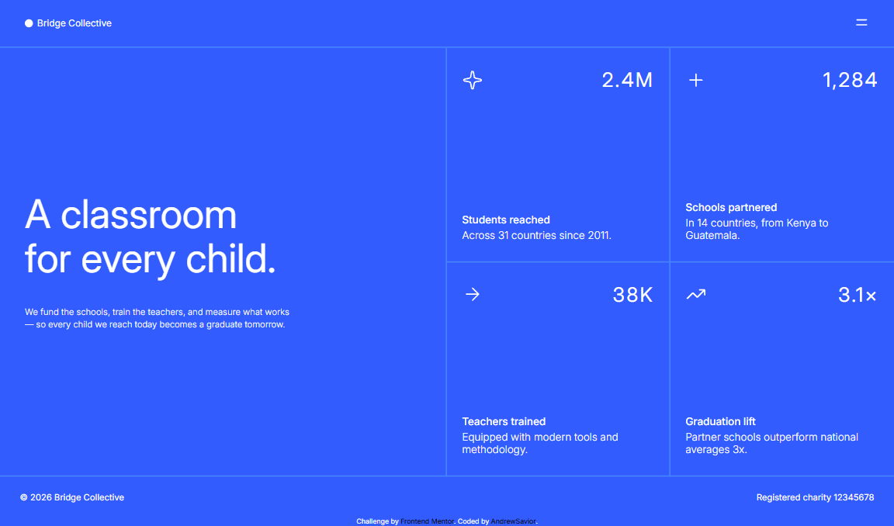
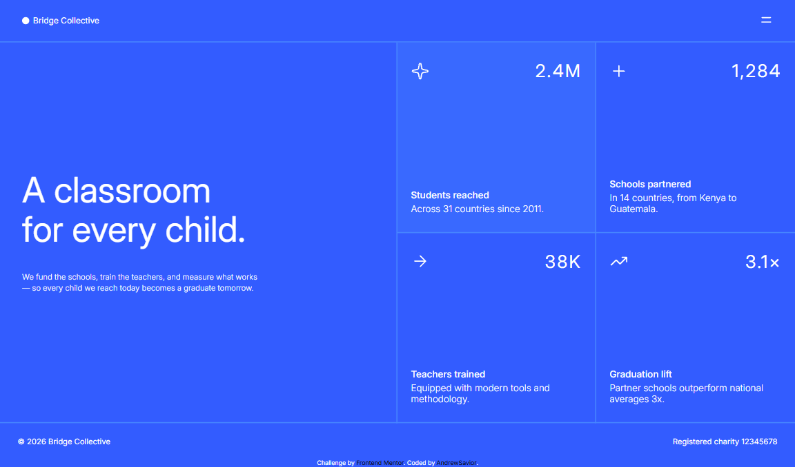
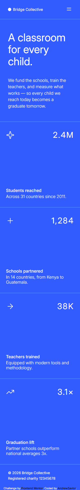
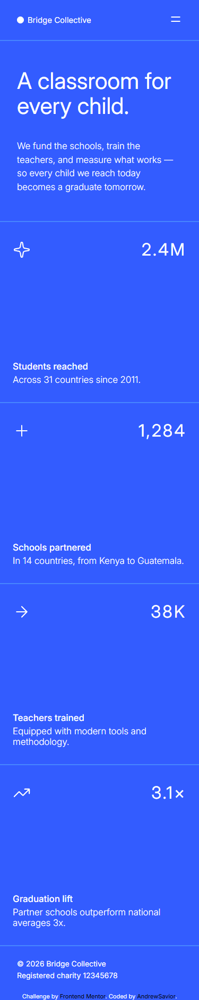

# Frontend Mentor - Grid landing page solution

This is a solution to the [Grid landing page challenge on Frontend Mentor](https://www.frontendmentor.io/challenges/grid-landing-page). Frontend Mentor challenges help you improve your coding skills by building realistic projects.

## Table of contents

- [Overview](#overview)
  - [The challenge](#the-challenge)
  - [Screenshot](#screenshot)
  - [Links](#links)
- [My process](#my-process)
  - [Built with](#built-with)
  - [What I learned](#what-i-learned)
  - [Continued development](#continued-development)
  - [Useful resources](#useful-resources)
  - [AI Collaboration](#ai-collaboration)
- [Author](#author)
- [Acknowledgments](#acknowledgments)

## Overview

### The challenge

Users should be able to:

- View the optimal layout for the page depending on their device's screen size
- See hover and focus states for all interactive elements on the page
- Open and close the navigation menu at any screen size (optional JavaScript)

### Screenshot

1.Desktop:

2.Desktop active:

3.Mobile 320px:

4.Mobile 375px:

### Links

- Solution URL: [Add solution URL here](https://your-solution-url.com)
- Live Site URL: [Add live site URL here](https://your-live-site-url.com)

## My process

### Built with

- Semantic HTML5 markup
- CSS custom properties
- Flexbox
- CSS Grid
- Mobile-first workflow

### What I learned

Css nesting

### Continued development

Its not the final version of this challenge, I still dont know JS.
After I learn smth about DOM monipulation Im gonna continue this challenge and make a burger menu.
For now I cant do this challenge because I don't know JS.

### AI Collaboration

Didn't use.

## Author

- Website - [AndrewSavior](https://github.com/HauviG)
- Frontend Mentor - [@HauviG](https://www.frontendmentor.io/profile/HauviG)

## Acknowledgments

For this challenge I use - [@otaviozerotwo](https://github.com/otaviozerotwo/Grid-landing-page) repository only for Learning and practice.
